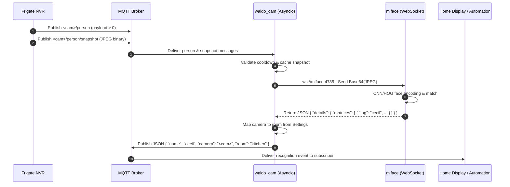

# waldo_cam Architecture & Design

This document details the architectural design, event processing flow, and event-loop integration for [`waldo_cam`](file:///home/ccoupe/Projects/iot/waldo_cam/waldo.py).

## System Flow Diagram



## Core Architectural Components

### 1. Event Loop Integration (`asyncio`)

In high-concurrency or distributed IoT environments, blocking I/O (such as waiting for neural network inference over a socket) can stall MQTT message handling.

[`waldo_cam`](file:///home/ccoupe/Projects/iot/waldo_cam/waldo.py) integrates `asyncio` with MQTT using a producer-consumer pattern:
1. **MQTT Thread / Ingestion:** `paho-mqtt` runs its background network thread (`loop_start()`). When `on_message` callbacks fire from MQTT subscriptions, messages are placed onto an `asyncio.Queue` in a thread-safe manner using `loop.call_soon_threadsafe()`.
2. **Asyncio Event Loop:** The primary application loop consumes events from the queue asynchronously.
3. **Async WebSocket Client:** Uses asynchronous `websockets.connect()` so that queries to `mlface` are fully asynchronous coroutines. If `mlface` takes 0.5s–2.0s to process a high-resolution frame, other camera updates are not blocked.

### 2. Snapshot & Detection Synchronization

Frigate publishes person detection on `<prefix>/<camera>/person` and images on `<prefix>/<camera>/person/snapshot`. 

**The 270x270 Resolution Bottleneck:**
Frigate's MQTT publisher intentionally downscales snapshot images to 270x270 to minimize MQTT payload sizes across brokers. However, `dlib`'s CNN/HOG face detection models in `mlface` require faces to be at least ~80x80 pixels. Within a 270x270 frame, a person's face often measures only 25–40 pixels, resulting in dropped facial recognitions.

**Dual-Path Snapshot Strategy:**
1. **Direct HTTP Snapshot Fetch (Primary):** When `[frigate] url = "http://<frigate_ip>:5000"` is configured, `waldo_cam` retrieves the pristine, full-resolution snapshot directly via Frigate's REST endpoint (`/api/<camera>/person/snapshot.jpg` or `/api/<camera>/latest.jpg`) in ~40ms asynchronously without blocking the event loop.
2. **MQTT Snapshot Cache (Fallback):** If HTTP is unconfigured or temporarily unreachable, `waldo_cam` seamlessly falls back to the MQTT snapshot stream (`_snapshots[camera_name]`). When a `person > 0` message arrives, if a recent snapshot exists in memory, it is used immediately; otherwise, it waits up to 1.5 seconds on an `asyncio.Event` for the snapshot packet to arrive.

### 3. Cooldown & Debouncing

When someone is standing in a room, Frigate continuously tracks the person and may publish multiple snapshot updates. To conserve GPU/CPU cycles on the `mlface` host:
- Each camera maintains a `last_query_time` timestamp.
- If a new trigger occurs within `cooldown_seconds` (default: 10s), the request is skipped unless a new motion activation occurs after returning to 0.

### 4. Payload Schemas

#### Incoming from `mlface`
```json
{
  "details": {
    "plug": "face",
    "name": "face",
    "reason": "face",
    "matrices": [
      {
        "x": 240,
        "y": 180,
        "width": 120,
        "height": 140,
        "tag": "cecil",
        "confidence": 1.00
      }
    ],
    "imgWidth": 1920,
    "imgHeight": 1080,
    "time": 0.354
  }
}
```

#### Outgoing to MQTT (`frig-fc/face-recog`)
```json
{
  "name": "cecil",
  "camera": "mantle_cam",
  "room": "kitchen",
  "confidence": 1.0,
  "timestamp": 1728864000.123
}
```
